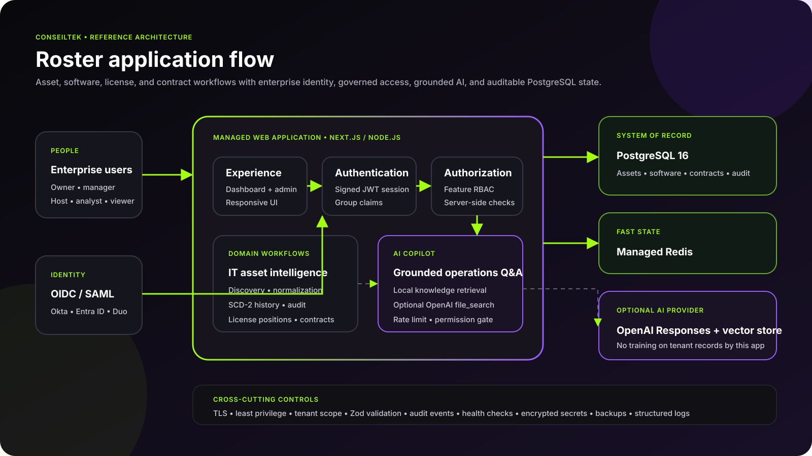
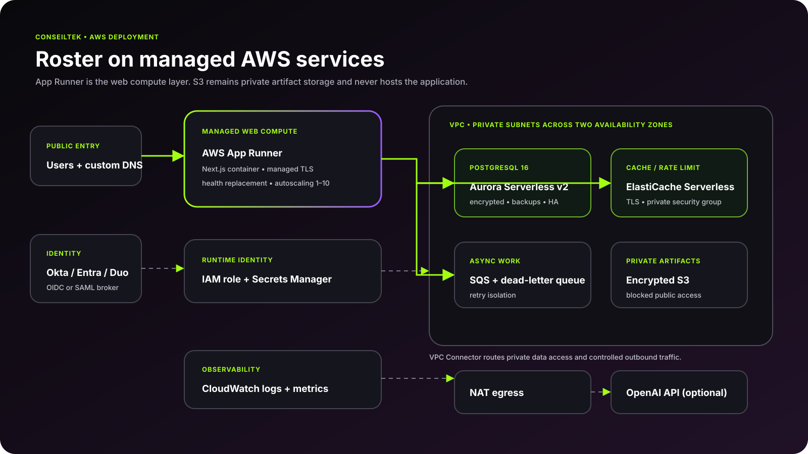
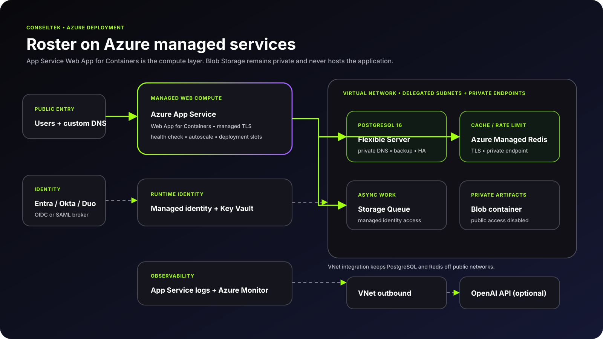

<div align="center">
  
  <h1>Roster</h1>
  <p><strong>IT asset, software, license, and contract intelligence in one system.</strong></p>
  <p>Enterprise SSO · feature-level RBAC · PostgreSQL history · grounded AI · AWS and Azure infrastructure as code</p>
</div>

[](https://github.com/ConseilTek-Tektons/roster/actions/workflows/ci.yml)
[](https://github.com/ConseilTek-Tektons/roster/actions/workflows/codeql.yml)
[](LICENSE)

Roster is a deployable ConseilTek reference application for hardware inventory, software discovery, title normalization, license positions, contracts, and optimization. It includes an interactive estate dashboard, temporal PostgreSQL history, reconciliation logic, AI-assisted operations, enterprise identity, containers, and validated AWS/Azure infrastructure.



## What is included

- Working Next.js 15 experience with inventory search/filter, estate charts, discovery status, license positions, and CSV export
- PostgreSQL 16 model for assets, SCD-2 asset history, software titles/installations, entitlements, contracts, and reconciliation runs
- Non-overlapping `tstzrange` validity periods for temporal asset versions
- License reconciliation with shortfall exposure and reclaim-value calculations
- Feature-level RBAC for ITAM administrators, asset managers, technicians, auditors, and viewers
- OIDC for Okta and Microsoft Entra ID; SAML providers such as Duo connect through Keycloak or another broker
- AI asset-intelligence copilot with grounded local retrieval and optional OpenAI Responses API `file_search`
- Redis distributed limits, audit events, health checks, Zod validation, migrations, seed data, and tests
- Local Docker Compose stack with PostgreSQL, Redis, and a preconfigured Keycloak realm
- Validated AWS App Runner/Aurora PostgreSQL Serverless and Azure App Service/PostgreSQL Flexible Server IaC

## Run the complete local stack

```bash
cp .env.example .env
docker compose up --build
```

Open [http://localhost:3000](http://localhost:3000), or inspect the local identity broker at [http://localhost:8080](http://localhost:8080). See [Authentication](docs/AUTHENTICATION.md). Demo personas exercise different access levels; production disables demo sign-in by default.

For manual development with Node.js 22+ and pnpm 11:

```bash
pnpm install
pnpm db:migrate
pnpm db:seed
pnpm dev
```

## Cloud deployment

Roster has server-rendered pages, authenticated APIs, SSO callbacks, database transactions, exports, and AI orchestration. It should not be hosted as a static web app.

| Cloud | Managed web compute | PostgreSQL | Cache | Deployment guide |
|---|---|---|---|---|
| AWS | AWS App Runner | Aurora PostgreSQL Serverless v2 | ElastiCache Serverless | [Terraform](infra/aws/README.md) |
| Azure | Azure App Service Web App for Containers | PostgreSQL Flexible Server | Azure Managed Redis | [Bicep](infra/azure/README.md) |

These services reduce routine maintenance across runtime availability, TLS, scaling, database patching/backups, and cache operations. Private S3/Blob storage may hold evidence or import artifacts; it never hosts the application.





## Read the implementation guides

- [Architecture and data history](docs/ARCHITECTURE.md)
- [Okta, Entra ID, Duo, OIDC, and SAML](docs/AUTHENTICATION.md)
- [RBAC policy](docs/RBAC.md)
- [AI and RAG](docs/AI.md)
- [Security](docs/SECURITY.md)
- [Operations](docs/OPERATIONS.md)

## Quality gates

```bash
pnpm check
terraform -chdir=infra/aws validate
bicep build infra/azure/main.bicep
docker build -t roster:local .
```

CI repeats application, container, Terraform, and Bicep validation for every pull request.

## Repository map

```text
src/app/                 pages and authenticated API routes
src/components/          application shell, inventory dashboard, AI, access UI
src/config/              product and RBAC policy configuration
src/lib/                 authorization, DB, reconciliation, retrieval, limits
db/migrations/           asset, history, software, license, contract schema
knowledge/               approved documents for optional RAG ingestion
deploy/keycloak/         local identity broker
infra/aws/               App Runner architecture in Terraform
infra/azure/             App Service architecture in Bicep
docs/architecture/       editable SVG architecture diagrams
```

## License

Apache 2.0. See [LICENSE](LICENSE). ConseilTek trademarks and supplied brand artwork remain the property of ConseilTek.
